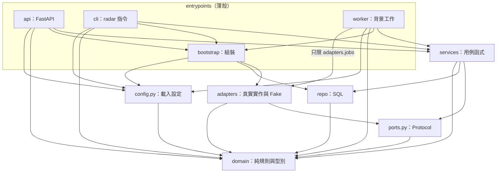
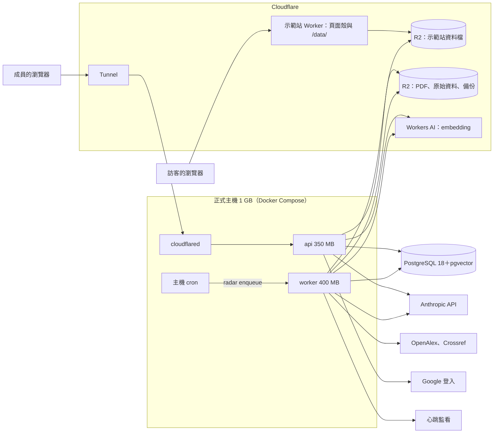
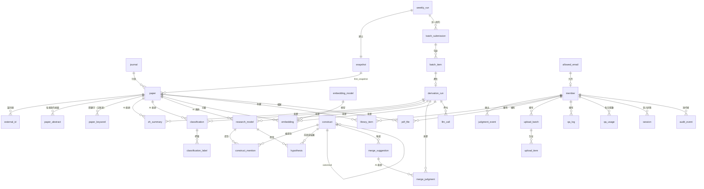

# Architecture Spine — Research Radar

這份文件只寫「各個 Story 分開做的時候，不約定就會做得不一樣」的事。理由在 `docs/adr/`，名詞在 `docs/glossary.md`。每條規則有固定編號（AD-n），之後只會修改內容或往後加，不會重新編號。檔案清單、排程表、欄位清單這類細節以對應 ADR 的「決定」一節為準。

用語和 PRD 的對照：這裡的「出處」是 PRD 的「引用」，「中文重點」是「中文結構化摘要」，「試用環境」是 staging，「工作」是「任務」。

## Design Paradigm

**模組化單體＋分層。** 後端是一個 Python 套件 `radar`，一個映像，三種啟動方式（api、worker、cli）。只有外部服務做成可替換（port／adapter）；資料庫只有 PostgreSQL，停在 Repository。

| 層 | 目錄 | 放什麼 |
| --- | --- | --- |
| 領域 | `radar/domain/` | 純規則與資料型別，不做任何 I/O |
| 用例 | `radar/services/` | 一個功能一個普通函式；交易的邊界在這一層 |
| 資料 | `radar/repo/` | 全部的 SQL 與 ORM 模型 |
| 轉接 | `radar/adapters/` | 每個外部服務的真實實作與 Fake |
| 入口 | `radar/entrypoints/` | `api`、`cli`、`worker` 三個薄殼，加上組裝用的 `bootstrap.py` |
| 前端 | `web/` | 一份 React 程式，兩種建置（成員版、示範站） |



箭頭是「可以 import」。圖上沒有的箭頭就是不可以。

## Invariants & Rules

### AD-1 — 分層與 import 方向

- **Binds:** `radar/` 全部程式
- **Prevents:** SQL、HTTP、SDK 呼叫散在各功能裡，換來源、換模型、加入口時要改一片；核心邏輯不連網路就測不了
- **Rule:**
  - import 只能照上圖的方向，全部寫成 import-linter 契約，CI 不過不能合併。
  - 套件的位置：`sqlalchemy`、`pgvector` 只出現在 `radar.repo`；`httpx2`、`anthropic`、`boto3`、`pypdf`、`joserfc` 只出現在 `radar.adapters`；`procrastinate` 只出現在 `radar.adapters.jobs` 與 `radar.entrypoints.worker`；`fastapi` 只出現在 `radar.entrypoints.api`；`typer` 只出現在 `radar.entrypoints.cli`。`radar.domain` 連間接都不得 import 這些套件。
  - 入口不得 import `radar.repo` 與 `radar.adapters`（`bootstrap.py` 除外；worker 另外可以 import `radar.adapters.jobs`）。`api`、`cli`、`worker` 互相不 import。
  - `radar.config` 只被入口與 `bootstrap.py` import。設定的型別定義在 `radar/domain/settings.py`，services 從參數收設定物件。
  - 入口只做三件事：解析輸入、組裝、呼叫一個 services 函式。每週更新、匯入、匯出、評估、備份、還原、遷移都有對應的 `radar` 指令（NFR-11）。

### AD-2 — 外部服務只經 port 或注入的函式，都有測試替身

- **Binds:** FR-8～FR-10、FR-12～FR-17、FR-26～FR-28、FR-34、FR-48、NFR-6
- **Prevents:** 某個功能直接呼叫 SDK，離線測試跑不起來；各 adapter 回傳各家自己的資料形狀
- **Rule:**
  - **port 只有四個**，定義在 `radar/ports.py`（`typing.Protocol`）：`PaperSource`、`LlmProvider`、`EmbeddingProvider`、`ObjectStore`。前三個是設計原則文件點名的三類；`ObjectStore` 是明列的例外（理由見 ADR-0001）。
  - **其餘外部服務不建 Protocol，用函式注入**：讀 PDF、登入（換授權碼並驗 ID token）、送心跳、排入背景工作。services 的參數型別是 `Callable`，簽名只用 `radar.domain` 的型別；真實的函式在 `radar/adapters/`，測試替身在 `adapters/fake/`。
  - services 從參數收 port 與函式，不 import adapters；只有 `entrypoints/bootstrap.py` 建立 adapter、選實作。adapter 的回傳值一律是 `radar.domain` 的型別（`PaperSource` 回傳的是還沒解析的原始紀錄，見 AD-25）。
  - 新增 port 的條件：有第二種真實的實作（不同的來源或供應商）；測試替身不算。不建 registry 或 factory 類別。CI 用 pytest-socket 封鎖網路。

### AD-3 — 讀取一律帶 viewer

- **Binds:** FR-7、FR-28、FR-35、FR-42、FR-49、FR-50、ARCH-15
- **Prevents:** 某一條讀取路徑（問答檢索、搜尋、匯出、示範站產生器、背景工作）忘了過濾，私人資料外洩
- **Rule:**
  - Viewer 的型別定義在 `radar/domain/viewer.py`，三種：`MemberViewer`（成員 ID、是不是管理者）、`PublicViewer`、`SystemViewer`。
  - 誰可以建立哪一種：
    - `MemberViewer`：api 的登入相依項（由 session）；worker 處理使用者觸發的工作時（由狀態列的 `owner_id`，例如上傳辨認）；CLI 指令帶 `--as <管理者 email>` 時。
    - `PublicViewer`：只有 `services/demo_export.py` 與展示問答。
    - `SystemViewer`：只用在沒有特定使用者的工作（匯入、每週更新、Batch、維運）。
  - `radar.repo` 的公開函式名稱只能用架構測試裡登記的前綴，分讀取類與寫入類；讀取類的第一個參數必須是 `viewer`、沒有預設值；沒登記的名稱直接失敗。不帶 viewer 的讀取只有測試裡列名的例外：登入流程對 `session`、`login_attempt`、`allowed_email` 的查找。
  - 狀態表只存 ID 與自己的資料，不存別的表的內容；要顯示的候選清單在顯示時用當事人的 viewer 查。
  - 沒登入回 401；沒有權限與資料不存在回同一個 404。
  - FR-7 的換人測試以 `openapi.json` 的端點清單為準，每個端點要有測試，或列在豁免清單並寫理由；預期結果是「404 或空清單」。金絲雀測試涵蓋問答、搜尋、匯出、示範站檔案、日誌、上傳時的標題候選。

### AD-4 — 可見範圍的規則只有一份

- **Binds:** FR-7、FR-12、FR-13、FR-35、FR-49、FR-50
- **Prevents:** 各查詢各自解讀「誰看得到」；衍生資料的可見範圍和論文不一致
- **Rule:** 可見條件只寫在 `repo/visibility.py`，其他查詢從它組合。
  - 成員看得到一篇論文 ⇔ `paper.lab_visible` 為真，或這位成員的 `library_item` 有它。
  - `PublicViewer` 看得到的論文 ⇔ 在 `counted_paper` 裡（AD-5）。
  - 論文的衍生資料（摘要、AI 產出、向量、構面提及、假設）跟隨論文。例外：`paper_abstract` 的來源是成員上傳的 PDF 時，只有上傳者讀得到。
  - `pdf_file`、`upload_batch`、`upload_item`、`library_item`、`qa_log`、`qa_usage` 只有擁有者讀得到；這些表都有 NOT NULL 的 `owner_id`（schema 體檢測試）。需要讓別人知道「來源檔案已刪除」時，由衍生事實自己記這個狀態，不靠讀別人的 `pdf_file`。
  - `library_item` 對（成員, 論文）唯一，記 `added_via`（`upload` 勾了下載聲明的上傳、`shared_list` 沒勾聲明的推薦清單、`manual` 自己按加入）與來源的 `upload_item`（可以是空的）。同一篇再加入一次時不改原本那一筆，所以 `added_via` 只代表第一次怎麼加入。文獻庫的「我上傳的／別人分享的／我自己加入的」篩選看 `added_via`，一次選一個；「有我的 PDF」開關與「看有 PDF 的論文」看的是這位成員對這篇有沒有還沒刪的 `pdf_file`，不看 `added_via`，兩者可以同時用（Kevin 2026-11-13 定案）。`paper.origin` 是論文怎麼進資料庫的，不代表某位成員怎麼加入的。
  - `lab_visible` 只由 `repo/papers.py` 寫，只在三種情況設為真：追蹤範圍內的論文入庫、引用擴展、上傳批次勾了分享（AD-24）。設為真之後不改回去。`in_scope` 為真的論文 `lab_visible` 必為真（`CHECK` 約束）。手填書目的論文 `lab_visible` 為假。
  - 架構測試：`lab_visible` 這個欄位名只出現在 `repo/visibility.py` 與 `repo/papers.py`。
  - 不加 `workspace_id`。

### AD-5 — 「哪些論文算數」只有一個定義

- **Binds:** FR-8、FR-11、FR-19～FR-25、FR-40、FR-42、FR-44、FR-49、ARCH-14
- **Prevents:** 某個統計把追蹤範圍外、非研究文章、還沒發佈的論文算進去，同一個數字在不同頁面對不起來
- **Rule:** `in_scope` 由 `domain/scope.py` 的 `is_in_scope(期刊, 出版年, 設定)` 在入庫時判定並存欄位；設定變更後用 `radar rescope` 重算。非研究文章記在 `excluded_reason`，不刪除。所有統計（趨勢、覆蓋率、關係、首頁讀數、示範站）只從 view `counted_paper` 出發：`in_scope` 為真、`excluded_reason` 為空、`first_snapshot_id` 指向已發佈的快照（AD-19）。統計查詢只放在 `repo/stats.py` 與 `repo/relations.py`，這兩個模組不得直接查 `paper` 表（架構測試）。

### AD-6 — 識別碼正規化與論文寫入的單一入口

- **Binds:** FR-6、FR-8、FR-9、FR-12、FR-49
- **Prevents:** 匯入、上傳、推薦清單各自比對 DOI，同一篇論文變成兩筆
- **Rule:** `domain/identifiers.py` 的 `normalize_doi`、`normalize_issn_l`、`normalize_openalex_id` 是唯一的正規化函式（性質測試：做兩次等於做一次）。`external_id` 表對（scheme, value_norm）有唯一約束。論文只能經 `repo.papers.upsert_by_external_id` 建立，它只接受 `ParsedPaper`（AD-25）；沒有任何識別碼的手填書目只能經 `repo.papers.create_manual`。`paper` 記 `origin`（`tracked`／`expansion`／`import`／`manual`）；手填的另外記是誰填的。

### AD-7 — AI 產出的來歷、版本與狀態

- **Binds:** FR-1、FR-3、FR-4、FR-11、FR-14、FR-15、FR-17、FR-18、FR-37
- **Prevents:** 某張 AI 表缺來歷；重跑蓋掉舊結果；換模型還沒評估就生效；各 Story 對「還沒有 AI 產出」回不同的形狀
- **Rule:**
  - **一次產出一列表頭。** AI 表頭表有四張：`zh_summary`、`classification`、`research_model`、`merge_judgment`。一次產出多列的資料掛在表頭底下，不帶自己的狀態：`classification_label`（`field` 是 `topic` 或 `method`，加 `key`）掛在 `classification`；`construct_mention` 與 `hypothesis` 掛在 `research_model`。
  - **表頭的欄位**（都是 NOT NULL，`abstract_id` 除外）：`run_id`（指向 `derivation_run`）、`input_kind`（`title`／`abstract`／`fulltext`）、`input_sha256`、`abstract_id`（用的是哪一筆摘要）、`lang`（BCP 47：`zh-Hant`、`en`，沒有語言的產出用 `zxx`）、`status`（`candidate`／`active`／`superseded`／`rejected`）。
  - **單一有效版本**：每張表頭表對（對象, `lang`）有部分唯一索引，保證只有一筆 `active`。對象是論文；`merge_judgment` 的對象是一筆合併建議。內容欄位不 UPDATE：重跑是新增一筆，再把舊的標成 `superseded`。
  - **候選**：換模型與「同一篇跑兩次」的結果存成 `candidate`，不顯示、不進統計；評估用的重複執行怎麼跑見 AD-8。`candidate` 變成 `active` 只經一個 CLI 指令（`radar runs promote`）：要指定是哪一次 `eval_run`，先核對那一次的一致率與同意率不低於門檻（FR-4）；同一個對象在那一次有多筆候選時用最早執行的那一筆，其餘改成 `superseded`；每一筆都經 AD-8 的寫入函式啟用，輸入已經變了的跳過並計數。
  - **不算 AI 表頭表的**：`embedding` 只帶 `run_id` 與 `input_sha256`，同一個主鍵直接覆寫（AD-12）；`merge_suggestion` 的前兩層不是模型產出，沒有 `run_id`。
  - **論文層級的擷取結果**（研究情境、研究限制、是不是文獻回顧或後設分析）放在 `research_model` 表頭。研究情境的國家、產業、研究設計、分析單位只能是 `config/` 情境值清單裡的 `key`，對不上就存空值。
  - **沒提到就存空值。** 模型不得把「摘要未提及」這類字寫進欄位；畫面上的字由 i18n 出。
  - **摘要**存在 `paper_abstract`（一篇可以有多個來源）。每篇最多一筆 `is_current`（部分唯一索引），只由 `repo/papers.py` 在寫入摘要時依設定檔的來源優先順序決定。LLM 輸入、向量輸入、全文檢索、問答內容、畫面顯示、「有摘要」的計數與篩選、示範站匯出，都只用這一筆；換了一筆等同摘要變動。
  - **讀取**：每張表頭表有一個 `effective_*` view（AD-10）；`repo` 裡除了該表的寫入模組，其他查詢不得直接讀 AI 表（架構測試）。
  - **API 與示範站檔案裡的 AI 區塊是同一個信封**：`state`、`value`、`provenance`（模型、產生時間、`input_kind`、是否經人工核對）。`state` 固定八個值：`ready`、`empty`（跑過了，沒有可擷取的內容）、`pending_interactive`、`pending_batch`、`deferred_budget`、`no_input`、`failed`（被拒收，或所屬的批次停在 `needs_attention`）、`not_applicable`（這種論文不做這個工作，AD-30）。只有 `ready` 與 `empty` 帶 `provenance`，只有 `ready` 帶 `value`。判定只寫在 `repo/ai_blocks.py` 的一個函式，所有端點與示範站匯出共用。`failed` 是終點狀態：不會自動再跑，要等管理者處理（AD-8、AD-14），畫面不得把它顯示成還在產生；`pending_*` 只用在一定會再跑的情況。舊的 `active` 不因為新的一次被拒收而失效。
  - schema 體檢測試檢查表頭表的欄位與索引；契約測試檢查 API 模型。

### AD-8 — 所有 LLM 呼叫只走一個閘門

- **Binds:** FR-1、FR-3、FR-14、FR-15、FR-17、FR-18、FR-28、FR-41、FR-43、NFR-2、NFR-3、NFR-4、NFR-5、NFR-14
- **Prevents:** 某個功能繞過預算、帳本、來歷或輸出驗證；同一份輸入被互動呼叫與 Batch 各跑一次
- **Rule:**
  - `LlmProvider` 只能被 `services/llm_gateway.py` 呼叫（架構測試）。
  - **要不要跑只有一個判定。** 閘門的 `should_run(對象, 工作代碼, prompt 版本, 模型, input_sha256)`：這組鍵已經有 `active` 的結果、有不屬於評估的 `rejected` 結果，或有不屬於評估的進行中 `derivation_run`，就不跑。評估留下的 `candidate` 不算，不會擋住平常的流程。`input_sha256` 是送給模型的內容加上會影響結果的設定檔版本（分類表、情境值清單）一起算的指紋，所以分類表改版等於輸入變了。`rejected` 只有 CLI（`radar runs retry`）能要求重跑。互動呼叫與 Batch 都先問它。每週更新對所有 `plan_for`（AD-30）要做的論文問一次，不只問這一週新收的；所以暫時性的失敗下一週自動補跑，被拒收的不會。
  - **同一份輸入同時只有一個在跑。** `derivation_run` 有狀態（`running`、`succeeded`、`failed`），對這組鍵有部分唯一索引，只算 `running` 的。取得執行資格是一個短交易：先對這組鍵取 advisory lock，重新問一次 `should_run`，還是要跑才新增 `running` 的那一筆；不用跑或新增失敗，這一次直接結束、不呼叫。只靠唯一索引不夠：先查過的另一個工作可以等前一個做完、`running` 消失後再新增。互動呼叫與 Batch 都走這一步（Batch 在建立 `batch_item` 的同一個短交易）。
  - **`running` 怎麼結束。** 互動呼叫有硬性時間上限（設定值，含連線層的重試）；`sweep` 的時限比它長，超過還是 `running` 的改成 `failed`（AD-14），不交人工。結果寫入時那一筆 `derivation_run` 必須還是 `running`，寫入的同一個交易把它改成 `succeeded`；已經被改成 `failed` 才回來的結果不啟用，只存成 `superseded`，帳照記。`derivation_run` 是 `failed` 的結果永遠不能啟用，新結果入庫與 `promote` 都一樣。Batch 的 `running` 不看時限，跟著批次的結果走。
  - **評估的重複執行是唯一的例外。** `radar eval` 帶著 `eval_run` 的 ID 呼叫閘門：不問 `should_run`，那一筆 `derivation_run` 記 `eval_run_id`、不算進上面的唯一索引，結果一律存成 `candidate`；外送檢查、預算、帳本、驗證照舊。
  - **拒收與暫時性失敗分開。** 模型拒答、長度截斷、格式或規則驗證沒過、請求本身不合法：寫一筆 `rejected`（帶失敗原因的代碼），不自動重試。逾時、限流、服務端錯誤、Batch 項目過期或被取消：不寫結果，由連線層與工作層重試，再不行就留給下一次每週更新。
  - **固定步驟**：外送檢查（AD-9）→ 預算檢查 → 從 `prompts/<工作>/v<N>.md` 組 prompt → 寫 `derivation_run` → 呼叫 → 寫 `llm_call`（費用由 `domain/pricing.py` 依 `config/models.yaml` 計算）→ Pydantic 驗格式 → 該工作的 domain 驗證 → 寫入結果。任一步驗證沒過，該筆標 `rejected`，不成為有效資料。例外：清單外的分類標籤與研究情境值只丟掉那一個並計數，不算拒收（FR-15）；標籤全部被丟掉時這篇是 `unclassified`。
  - **三種呼叫方式對應同一組步驟**：同步呼叫照上面的順序；串流（問答）邊送邊驗（AD-13），`llm_call` 在串流結束或中斷時寫；Batch 在建立 `batch_item` 時寫 `derivation_run`，匯入結果時寫 `llm_call` 並驗證。
  - **帳本不跟著回滾。** `derivation_run`、`llm_call` 用自己的短交易寫入並立刻 commit；呼叫模型時不佔著開著的交易。
  - **結果只有一個寫入處。** 每個工作代碼的結果只經 `services/ai_results.py` 的一個函式寫進 AI 表（它負責把舊的標成 `superseded`）；互動呼叫與 Batch 匯入共用。要寫成 `active` 之前，它在同一個短交易裡先鎖住這個對象（論文那一列；合併判斷鎖那一筆合併建議），再核對這筆結果的 `input_sha256`（實際送給模型的內容加設定檔版本）、prompt 版本、模型仍然是這個對象現在該用的，然後才切換；不是的話存成 `superseded`，不動現有的 `active`。核對和切換之間因此插不進別的寫入。
  - **啟用有兩個入口，上鎖、核對輸入與 prompt 版本、切換共用，只有兩處不同。** 新結果入庫（互動呼叫、Batch 匯入）：它的 `derivation_run` 必須還是 `running`，核對的模型是這個工作現在該用的。`radar runs promote`：那一筆結果必須還是 `candidate`、它的 `derivation_run` 必須是 `succeeded`，核對的模型是指定的那一次評估要切過去的。`derivation_run` 是 `failed` 的結果（被 `sweep` 判定失敗）兩個入口都不啟用。
  - `derivation_run` 一次模型呼叫一筆，記工作代碼、prompt 版本與雜湊、模型、參數、用到的設定檔版本（分類表、情境值清單）、程式版本。
  - 模型 ID 寫在 `config/models.yaml`（一種工作一個設定）；思考設定、effort、長度上限寫在 prompt 檔的設定區，屬於 prompt 版本的一部分。模板或設定區改了卻沒升版，測試失敗。
  - 模型拒答與長度截斷是各自的錯誤型別。所有呼叫都不給工具。單次輸入預估（含系統提示與快取的部分）超過 100,000 tokens 時拒絕送出，該工作設定明確允許者除外。
  - 工作代碼固定為：`zh_summary`、`classify`、`extract_model`、`merge_judge`、`qa_answer`、`eval_judge`。新增工作代碼要改這一條。向量化不經閘門，代碼是 `embed`（AD-12）。

### AD-9 — 送到雲端的內容必須先放行

- **Binds:** FR-7、FR-13、FR-42、ARCH-13
- **Prevents:** 新功能把付費全文或從付費 PDF 讀出的內容送給雲端 LLM 或 embedding 服務；「示範站可用」出現第二份定義
- **Rule:**
  - `LlmProvider` 與 `EmbeddingProvider` 的方法只接受 `CloudSafeText`，不接受 `str`：型別檢查（mypy）擋一次，adapter 入口在執行期再檢查一次，傳 `str` 會報錯（有測試）。
  - `CloudSafeText` 只能由 `domain/policy.py` 的 `clear_for_cloud(文字, 來源, 授權, 設定)` 建立（架構測試檢查沒有其他建立處）。付費來源的內容在 `RADAR_PAYWALLED_FULLTEXT_LLM` 關閉（預設）時建立不出來；兩種設定都有測試。
  - 「示範站可用」只由 `domain/policy.py` 的 `is_demo_eligible` 判定，入庫時算好存成論文的 `demo_eligible` 欄位，授權資料變了就重算。
  - 「示範站有完整內容」只定義在 view `demo_full_paper`：在 `counted_paper` 裡、`demo_eligible` 為真、有目前的摘要、摘要來源允許公開。檢索的 `demo` 範圍、`DemoPaperFull`、關係可列出的來源論文、展示問答都讀它。

### AD-10 — 人工判斷事件只新增，有效值由 view 決定

- **Binds:** FR-4、FR-14 附則、FR-16、FR-18、FR-21、NFR-16
- **Prevents:** 各頁面各自決定用人工值還是 AI 值；重跑 AI 蓋掉人工修正；修正被改寫或刪除
- **Rule:**
  - 人工判斷都寫進同一張 `judgment_event`，`kind` 固定四個值：`classification_fix`、`merge_decision`、`summary_report`、`summary_report_resolution`。共同欄位：成員、當時的角色（`member`／`admin`）、理由、時間。對象用（種類, ID）表示，不限論文。
    - `classification_fix`：論文、`field`（`topic` 或 `method`）、新的整組標籤 `key`、被修正的那筆 AI 產出。
    - `merge_decision`：兩個構面（ID 小的在前）、決定、證據層級。
    - `summary_report`：被回報的那筆 `zh_summary` 與欄位；只對那一筆有效，重新產生後不跟過去。
    - `summary_report_resolution`：管理者對一筆回報的處理結果（`confirmed_ok` 或 `regenerated`），指向原本那筆回報，只經 CLI 寫入。「有成員回報此欄可能有誤」＝有回報而沒有處理結果，由 `effective_zh_summary` 算出。
  - 應用程式的資料庫角色對 `judgment_event` 與 `audit_event` 沒有 UPDATE、DELETE 權限（AD-17 的兩個角色；遷移裡設定，有測試）。
  - 有效值只由 `effective_*` view 決定：`effective_zh_summary`、`effective_classification`、`effective_research_model`。有效分類以（論文, `field`）為單位取最新一筆人工值，沒有才用 `active` 的 AI 值；「已核對」與「成員意見不同」也是這個單位，由同一個 view 算出。所有讀取（API、統計、示範站匯出）讀這些 view。
  - 合併是例外：有效值存在 `construct.canonical_id`（AD-16）。

### AD-11 — 檢索只有一套

- **Binds:** FR-26、FR-27、FR-28、FR-43、ARCH-6
- **Prevents:** 問答另寫一套檢索；某條檢索路徑漏掉可見範圍或 scope
- **Rule:**
  - 向量查詢與全文檢索的 SQL 只存在於 `repo/retrieval.py`。論文檢索只由 `services/retrieval.py` 的 `retrieve(viewer, query 或 paper_id, scope, filters, k, offset)` 呼叫；搜尋、找相似論文、問答、展示問答都用它。
  - `scope` 只有四個值：`personal`（本人的文獻庫）、`lab`（本人看得到的全部）、`tracked`（等於 `counted_paper`）、`demo`（等於 `demo_full_paper`，只接受 `PublicViewer`）。先套 viewer 的可見條件，再套 scope。
  - 兩條腿（向量、英文全文檢索）各取前 N 名，用 RRF 在一條 SQL 內融合；N 與 RRF 的 k 是設定值（預設 100 與 60）。不用重排模型。全文檢索的 `tsvector` 一篇一列，內容是標題加目前的摘要。
  - 向量腿有相似度下限（設定值），低於下限的不算結果。回傳排序後的論文 ID、名次與 `total`（算得上結果的篇數，最多到上限），不回傳內容。分頁用融合後名次的位移，不用 cursor。
  - embedding 服務連不上時不降級成只用關鍵字，回固定的錯誤代碼。
  - 唯一的另一個向量查詢是構面相似度：`repo/retrieval.py` 的另一個函式，同樣強制帶 `model_id`，只由 `services/merges.py` 呼叫（AD-16）。

### AD-12 — 向量的寫入與查詢

- **Binds:** FR-5、ARCH-13、ADR-0005
- **Prevents:** 兩個模型的向量被混在一起比；查詢與文件用了不同的編碼方式；換模型要停機
- **Rule:** `embedding` 表主鍵是（`item_type`, `item_id`, `model_id`），向量型別 `halfvec`；每個模型一個 HNSW 部分索引；模型登錄在 `embedding_model` 表（含維度），目前使用的模型由設定指定。任何向量查詢都必須帶 `model_id` 條件（`repo/retrieval.py` 的函式簽名強制）。`EmbeddingProvider` 分成 `embed_documents` 與 `embed_query` 兩個方法，不得互換；真實實作檢查回傳的長度等於登記的維度。論文的向量輸入固定是「標題＋空行＋目前的摘要」，沒有摘要只用標題；`input_sha256` 變了才重算。寫入只經 `services/embeddings.py`：它寫 `derivation_run`（工作代碼 `embed`）並把用量記進 `api_call`。換模型的流程：用新 `model_id` 回填 → 改設定 → 之後才刪舊的。

### AD-13 — 問答的內容、出處與串流契約

- **Binds:** FR-28～FR-31、FR-43、NFR-2、NFR-19、SM-3
- **Prevents:** 未驗證的出處出現在畫面；AI 產出被拿來當生成依據；前後端對串流格式的理解不同；紀錄、展示問答、串流各存一種形狀；刪了紀錄後題數歸零
- **Rule:**
  - **生成內容與出處**：送給模型的論文內容只有目前的原文摘要與已驗證的假設原句。模型看不到論文 ID，只能寫 `[n]`；伺服器用這一題的編號表把 `[n]` 換成論文 ID，不在表內的丟掉並計數。
  - **串流事件**：瀏覽器只收 SSE 事件，名稱固定：`route`、`status`、`text`、`citation`、`done`、`error`。每種事件的內容是具名的 Pydantic 模型，列進 `openapi.json`，前端型別照樣由它產生（AD-21）。前端只從 `citation` 事件產生出處與連結。`error` 的代碼用全站同一批（Conventions「錯誤」）。
  - **`route` 的值固定**：`answer`、`not_found`、`count_redirect`、`research_question`、`retrieval_only`。
    - 預算用完時由伺服器在呼叫模型前決定 `retrieval_only`；不送論文清單，前端收到後用同一句話改呼叫搜尋。
    - 其餘由模型輸出的第一行路由標記決定，伺服器對照固定清單，不在清單內當作失敗。
    - `not_found`、`count_redirect`、`research_question` 只顯示前端的 i18n 固定說明，模型後面寫的內容一律丟掉。`count_redirect` 可以帶一個主題 `key`，必須在設定檔的清單內，否則不帶。`research_question` 的兩個連結由前端用固定句型產生。
    - `answer` 結束時一個通過驗證的出處都沒有：`done` 帶 `grounded` 為假，前端把整段換成「找不到」的畫面。
  - **保存的形狀只有一種**：`QaAnswer`（`route`、`segments`、`dropped_citations`、`grounded`、`provenance`）。`segments` 是依序排列的文字段與出處段，`text` 與 `citation` 事件就是逐段送出的 segment。`qa_log`、`demo_qa`、示範站的 `qa.json` 存的都是它。
  - **題數**：記在 `qa_usage`（台北時間的日期）。只有 `route` 是 `answer`、`grounded` 為真、而且正常結束才加一。
  - 問答的原始回應只存在 `qa_log`，隨使用者刪除而消失；`llm_call` 只記長度、費用、request ID。
  - 成員版與展示問答走同一條管線。

### AD-14 — 背景工作：參數只放 ID，狀態放資料表，重跑不出事

- **Binds:** FR-1、FR-9、FR-12、FR-14、FR-49、NFR-5、NFR-18
- **Prevents:** 工作重跑產生重複資料或重複花費；工作之間用參數傳遞會過期的內容；Batch 被送兩次；worker 死掉後工作永遠卡住
- **Rule:**
  - 工作的參數只有 ID。長流程的進度存在狀態表，每張狀態表的狀態轉換只經過一個 services 函式。每個工作一開始先讀狀態，做過的步驟跳過。
  - 狀態的值固定：
    - `weekly_run`：`fetching`、`published`、`ai_done`、`exported`、`failed`。同一時間只能有一個 `fetching`（部分唯一索引）。
    - `batch_submission`：`queued`、`submitting`、`submitted`、`ended`、`imported`、`failed`、`needs_attention`。
    - `upload_item`：`received`、`identifying`、`matched`、`duplicate`、`needs_confirm`、`needs_manual`、`mismatch_confirm`、`lookup_deferred`、`failed`、`expired`。
  - 順序一律是：寫狀態列並完成交易 → 用注入的排入函式（AD-2）排入。
  - **`sweep`**（每 15 分鐘，由 cron 觸發）做兩件事：(a) 依一份登記清單（狀態表、起始狀態、要排入的工作、多久算卡住）把卡住的項目重新排入，新增狀態表的 Story 必須加一列；互動呼叫留下、超過時限的 `running` `derivation_run` 也在清單上，處理方式是改成 `failed`（時限比呼叫的硬性時間上限長，AD-8）；排隊中或執行中卡住的 `demo_export` 也在清單上；(b) 找出 worker 已經不在、卻還停在執行中的工作（Procrastinate 的 stalled job）並重試。
  - **Batch**：每個 `batch_item` 指向一筆 `running` 的 `derivation_run`，同一份輸入不重送由它的唯一索引保證（AD-8）；`custom_id` 就是 `batch_item` 的 ID（32 個十六進位字元）。送出前先寫意圖列；狀態停在 `submitting` 且沒有供應商的 batch ID 時不自動重送，標成 `needs_attention`。
  - **`needs_attention` 不會自己好。** 有這種批次時 `poll-batches` 不送心跳（管理者因此收到通知），底下項目的 AI 區塊是 `failed`（AD-7）。只由 `radar batches resolve` 解除：補上供應商的 batch ID 繼續等，或標成失敗、把項目的 `derivation_run` 改成 `failed`，留給下一次每週更新。`batch_submission` 記它屬於哪一次 `weekly_run`（可以是空的）。
  - **誰推進每週更新**：`poll-batches` 每次結束時呼叫 `weekly_run` 的狀態函式，由它判斷「這一週的 Batch 都結束了，或發佈後已滿 24 小時」並排入示範站匯出。其他地方不排這個工作（手動的 `radar export-demo` 除外）。已經匯出過的那一週之後又匯入了結果時，同一個函式判斷要不要再匯出一次：這一週沒有未結束的 Batch，而且最後一次匯入結果的時間晚於最近一次成功匯出的開始時間。排入匯出的順序固定，前三步在同一個交易裡：先鎖住那一筆 `weekly_run`；拿到鎖之後才讀最後匯入時間、最近成功匯出時間與進行中的 `demo_export` 並判斷，鎖之前讀到的不算數；還需要才新增一筆 `queued` 的 `demo_export`；交易完成後才排入工作。`demo_export` 對同一個快照有只算 `queued`、`running` 的部分唯一索引，已經有一筆就不再排。手動的 `radar export-demo` 走同一步。
  - **哪些走 Batch**：第一次匯入與每週更新的 AI 工作走 Batch；問答、使用者觸發的工作（上傳、推薦清單）走互動呼叫；之後新增的工作預設走 Batch。
  - 佇列四條：`ingest`、`ai`、`pdf`、`maintenance`。`pdf` 用同一把 Procrastinate `lock`，同時只跑一個。
  - 工作層的重試只處理「整個工作失敗」，次數與間隔放設定；連線層的重試見 Conventions。

### AD-15 — 排程在程式外面

- **Binds:** FR-9、FR-48、FR-49、NFR-11、NFR-18
- **Prevents:** 排程藏在 worker 裡，開兩個 worker 就重複觸發，也搬不上 K8s；一個工作的心跳蓋掉另一個工作的失敗
- **Rule:** 不使用 Procrastinate 的週期任務。所有排程都是外部排程器（Compose 用主機 cron，K8s 用 CronJob）執行 `radar enqueue <工作>`。排程表只有一份：`deploy/crontab`。服務啟動時不執行遷移，也不排任何工作；遷移是 `radar migrate`。心跳以檢查名稱區分：送心跳的函式（AD-2）收檢查名稱，一個排程一個網址，放設定。每個排程工作成功後送自己的心跳，失敗時不送；示範站匯出有自己的心跳 `demo-export`。

### AD-16 — 構面的身分、合併與關係的識別

- **Binds:** FR-17～FR-21、ARCH-3、ARCH-8
- **Prevents:** 合併之後無法推翻；關係的網址在合併後失效；研究篇數的規則在排行表、簡報、示範站各寫一份；新構面不在排行表上
- **Rule:**
  - **構面身分**：以 `domain/constructs.py` 的 `normalize_name` 結果為唯一鍵（不做字根還原）。`construct_mention` 與 `hypothesis` 永遠指向原本的構面，不因合併而改。`construct.canonical_id` 不可為空；新構面由 `repo/constructs.py` 建立時指向自己。
  - **合併**：合併是 `judgment_event`。`canonical_id` 之後只由 `repo.constructs.rebuild_canonical()` 改寫：從全部合併事件整個重算，每對取最新決定，管理者蓋過成員；接受的配對連成一組，代表是 ID 最小的構面；組內有任何一對的最新決定是拒絕時，這一組不合併，並列入 CLI 的待處理清單。它只由 `services/merges.py` 在寫入合併事件的同一個交易裡呼叫，開頭先取 advisory lock。
  - **關係**：關係＝（代表構面 A, 代表構面 B）有方向的一對，沒有自己的 ID；網址由兩個構面 ID 組成；用非代表的 ID 查詢時回應帶 `merged_into`，不自動跳轉。API 回傳的是關係的清單，畫法由前端決定（ARCH-3）。
  - **關係的數字只有一個定義**：view `relation_stats`。它的列只來自 `counted_paper` 的論文、有效的研究模型。它定義：研究篇數、支持篇數、混合支持、本資料庫中少見、合併未完成（任一端有沒審的合併建議，或落在有衝突而沒合併的那一組）、覆蓋率警告、最新年份、關係的主題、未出現的情境、情境未知的篇數。「已審合併的構面占比」是 `repo/relations.py` 的一個函式。排行表、證據簡報、示範站都讀它們。
  - 證據簡報全部由程式計算，不呼叫 LLM，不存在伺服器；回應帶產生時間。
  - **證據簡報可以匯出成一個固定的檔案**（`services/evidence_brief.py` 的匯出函式）。格式是單一 HTML 檔，裡面附一份機器可讀的 JSON（有自己的 Pydantic 模型與格式版本號）。檔案自己就看得懂、不需要再連回系統，內容：畫面上的完整簡報、快照編號與產生時間、每篇來源論文的 ID 與 DOI、用到的每一筆 AI 產出的 ID（`research_model` 表頭與它的 `run_id`）、影響這份簡報的人工判斷事件 ID（合併決定、分類修正）、設定檔版本（情境值清單、門檻）。檔案不含成員的姓名與 email。
  - **匯出只用匯出者的 viewer 讀資料**，走和畫面相同的 `repo` 函式；匯出者在畫面上看不到的內容，檔案裡也不會有，不得為了匯出另外用 `SystemViewer` 讀。金絲雀測試涵蓋匯出檔（AD-3）。
  - **匯出檔完全自給自足**：不向外載入任何字體、圖片、樣式或程式，也不含會執行的 script；樣式寫在檔案裡，字體用系統字體，JSON 放在不會執行的資料區塊。DOI 這類要人點了才開的連結可以有。來自論文與 AI 產出的文字一律跳脫後才寫進 HTML。測試檢查匯出檔裡沒有任何會自動載入的外部網址。
  - **整份匯出在同一個 REPEATABLE READ 的唯讀交易裡讀完**（和 AD-20 相同），數字、來源清單與各種 ID 來自同一個時間點。
  - **合併建議**分三層（名稱相同、相似度、LLM 判斷），第三層拿掉後前兩層必須照常運作。出現次數與候選只算 `counted_paper` 的論文裡的構面。已經有決定的配對不再建議。

### AD-17 — 部署：服務無狀態，資料庫在外面

- **Binds:** NFR-1、NFR-15、NFR-17、NFR-18、ARCH-11、ARCH-12、ARCH-16、ARCH-17、ARCH-18
- **Prevents:** 程式假設資料庫在本機或檔案在本機磁碟；正式主機被塞進吃記憶體的服務；資料庫連線被用光
- **Rule:**
  - **無狀態**：api 與 worker 不在本機磁碟保存任何需要留下來的東西（檔案進物件儲存，狀態進資料庫），重啟或多開一份不掉資料。
  - **資料庫**：在主機與之後的 K8s 叢集外面。兩個角色、兩個連線字串：應用程式角色（`DATABASE_URL`，api、worker 與一般 CLI 指令用）與擁有者角色（`RADAR_MIGRATION_DATABASE_URL`，只給 `radar migrate` 與 `radar restore` 用）。本機與 CI 用同樣的兩個角色。需要的功能（`uuidv7()`、pgvector 不低於 0.8.0、`pg_trgm`）在第一個遷移檢查。
  - **連線數預算**（以 35 條可用連線為準）：api 8、worker 6、每個 CLI 行程 2，其餘留給備份與人工連線；寫成 `config.py` 的預設值。
  - **正式環境的組成**：Compose 檔只有 `api`、`worker`、`cloudflared`；`mem_limit` 是 350 MB 與 400 MB；不含資料庫、GROBID、本機模型、UMAP。容器內所有行程（cron 觸發的 CLI、PDF 子行程、`pg_dump`）合計受 `mem_limit` 限制。每個容器設日誌的大小與份數上限。api 用單一 uvicorn 行程。對外只走 Cloudflare Tunnel。
  - **健康檢查與關機**：api 提供 `/healthz` 與 `/readyz`；收到 SIGTERM 時做完手上的工作再結束。worker 的 `shutdown_graceful_timeout` 與 Compose 的 `stop_grace_period` 成對設定，後者比前者長。
  - 每個 commit 由 CI 建出 amd64 與 arm64 的映像（AD-29）。

### AD-18 — 設定、秘密與遷移

- **Binds:** FR-36、NFR-9、NFR-10、NFR-15、FR-46
- **Prevents:** 秘密進 repo 或日誌；領域設定寫死在程式；各模組各自讀環境變數；設定檔的名稱被當成介面文字各放一份
- **Rule:**
  - 秘密、部署相關的值與開關只從環境變數讀（前綴 `RADAR_`，另有 `DATABASE_URL`），只經 `radar/config.py`；程式其他地方不讀 `os.environ`。正式主機的環境檔不進 repo，權限只給部署帳號。前端的建置變數（`VITE_BUILD_TARGET`、兩個站互連的網址）是另一組，不含秘密。
  - 領域設定是 `config/` 下的 YAML（期刊與旋臂順序、分類表、情境值清單、排除規則、摘要來源的優先順序、模型與價格、各種門檻與上限、外部服務的速率與額度、預算、CFP、關鍵字來源、展示問答題目），啟動時用 Pydantic 驗證，錯了就不啟動。PRD 裡標 `[ASSUMPTION]` 的門檻一律是設定，不寫死。prompt 在 `prompts/`。
  - 期刊、主題、方法在資料庫、API、網址、計數方塊、示範站檔案裡一律用設定檔的 `key`（小寫英文加底線）；未分類固定是 `unclassified`。它們的顯示名稱是資料，不是介面文字：由一個 API 端點與示範站的一個檔案提供，前端不放進 i18n。
  - 遷移用 Alembic，依命名慣例；破壞性變更分「擴充、遷移、收斂」三步；回填寫成可續跑的 CLI 工作。Procrastinate 自己的 SQL 腳本包在 Alembic 的遷移檔裡執行；`alembic check` 排除它的表。CI 跑 gitleaks 與 `alembic check`。

### AD-19 — 快照與數字

- **Binds:** FR-22、FR-23、FR-25、FR-40、FR-42、FR-44、UX 文件 H2、H6
- **Prevents:** 成員版與示範站的同一個數字算法不同；數字點下去的篇數和數字不一樣；匯入到一半的論文被算進去；某條入庫的路沒設快照，論文永遠不算數
- **Rule:**
  - **快照只有一個建立者。** `snapshot` 有遞增的 `number`、`as_of`、狀態；只由 `services/weekly_update.py` 建立與發佈，第一次匯入就是它的第一次執行（快照 1）。寫入成功時發佈，不等 AI，這時送 `weekly-update` 的心跳。
  - **抓取和寫入分兩段。** 抓取階段只寫 `raw/`、`raw_fetch` 與暫存表 `ingest_staging`（解析好的結果），不動論文資料，可以中斷後續跑。14 本都抓完後，在一個交易裡把暫存表套用到論文資料、寫 `first_snapshot_id`、發佈快照。中途失敗時，成員看到的資料與截至日期都不變。套用時舊資料不蓋掉新資料（AD-25）。
  - **唯一的例外是開放成員登入之前的第一次匯入。** 套用時間超過門檻（設定值，預設 10 分鐘）時，第一次匯入可以改成一本期刊一個交易；那時沒有成員、快照 1 還沒發佈，沒有人看得到寫到一半的資料。開放登入之後的每週更新一律是一個交易、最後一次切換，沒有這條退路。
  - **`first_snapshot_id` 只由每週更新寫。** 建立新快照時，把所有 `in_scope` 為真、而 `first_snapshot_id` 是空的或指向沒發佈成功的快照的論文，一律指到新快照。上傳、推薦清單、`rescope`、`reparse` 都不寫這個欄位。
  - 「本週新增」＝`first_snapshot_id` 是目前已發佈的快照。
  - **計數方塊**：後端與示範站只提供計數，不提供比例。形狀是列的清單，每列是（`journal`, `year`, `dim`, `key_a`, `key_b`, `n`）；`dim` 是 `total`、`with_abstract`、`topic`、`topic_pair`、`method`、`pending_classification` 之一；`topic_pair` 的 `key_a` 字母順序在前。
  - **比例只算一次**：占比、期刊等權、成長排名、未滿一年的判定、摘要覆蓋率、平均每年被引用次數只在 `web/src/stats/` 實作，成員版與示範站共用。驗收情境是 `tests/golden/stats/` 的資料檔，任何第二份實作都必須通過同一批檔案。唯一的第二份實作是 `relation_stats` 的覆蓋率警告（要在 SQL 裡算），它用同一批資料檔測。
  - 內容和論文統計有關的 API 回應都含 `snapshot`（`number` 與 `as_of`）。匯出的檔案與證據簡報另外帶產生時間。
  - **點得回去**：每一格計數都必須能用它的條件從論文清單查出相同篇數（有測試）。論文清單的條件：不同欄位之間是「且」；主題給多個值是「且」；期刊與年份給多個值是「或」。
  - `cited_by_count` 是論文的欄位，每週覆寫，不觸發重新處理。

### AD-20 — 示範站：白名單匯出，驗證過才換

- **Binds:** FR-7、FR-11、FR-42、FR-43、FR-44、ARCH-2
- **Prevents:** 成員資料、受授權限制的內容或白名單外的欄位流到公開網站；訪客看到更新到一半或新舊混在一起的資料
- **Rule:**
  - 產生器是 `services/demo_export.py`，只用 `PublicViewer` 經 repo 讀資料，不寫自己的 SQL。全部讀取（含自我檢查）在同一個 REPEATABLE READ 的唯讀交易裡完成。
  - **白名單**：每一種資料檔對應一個「多餘欄位即報錯」的 Pydantic 模型，全部列在 `demo-openapi.json`。論文層級的內容只有兩層：`DemoPaperBiblio`（全部論文，含論文 ID）與 `DemoPaperFull`（只有 `demo_full_paper` 的論文）。關係用 `DemoRelation`，問答用 `QaAnswer`。摘要來源是 Semantic Scholar 的論文，不輸出完整內容與分類標籤。
  - **每次匯出寫新目錄**：目錄名是匯出編號（快照編號加當次的序號，例如 `data/12-2/`），寫出後不改。舊目錄由匯出程式依 `demo_export` 的紀錄刪除，保留最近幾次（設定值），`manifest.json` 指向的那一次不刪。只有 `manifest.json` 會被覆寫，而且最後才寫；它記快照、匯出編號、匯出時間與首頁要用的摘要數字。每個資料檔最外層都有 `snapshot` 與匯出編號；前端的快取鍵用匯出編號。
  - **列順序是契約**：`papers-index.json`、`galaxy.json`、`titles.json` 的列順序相同；第 i 列的論文詳情在第 ⌊i÷200⌋ 個分片檔。
  - **關係**：`relations.json` 只輸出至少有一篇來源論文在 `demo_full_paper` 裡的關係，並帶全庫的關係總數；來源論文只列 `demo_full_paper` 裡的。
  - **寫 manifest 之前的自我檢查**：每個物件通過白名單模型；不在 `demo_full_paper` 的論文沒有完整內容欄位；找不到金絲雀字串與成員 email；每一格計數與首頁的讀數都能用 `papers-index.json` 重算；`relations.json`、`qa.json`、`home.json` 出現的每個論文 ID 都在 `demo_full_paper`；每條關係「計入研究篇數的可列出來源＋另有 N 篇」等於研究篇數。沒過就不換、不送 `demo-export` 心跳。
  - 頁面與資料同一個網域。`RADAR_DEMO_PUBLISH` 預設關；關的時候寫到 `preview/`，結構和正式的完全相同（含自己的 `manifest.json`）。
  - 展示問答由 `radar build-demo-qa` 走 AD-13 的管線（`PublicViewer`、scope `demo`）產生後存檔，匯出時只帶出。

### AD-21 — 前端：一份程式、兩種建置、一層資料來源

- **Binds:** FR-42、FR-44、NFR-12、NFR-13、UX 文件 Interaction Primitives
- **Prevents:** 示範站另寫一套頁面；頁面直接連 API 導致示範站不能用；前後端型別各寫各的；同一種資料在 API 與示範站檔案各有一個形狀
- **Rule:**
  - 頁面與元件不得呼叫 `fetch`，也不得 import `datasource/api` 或 `datasource/static`，只能用 `datasource/types.ts` 定義的函式（ESLint 規則）。示範站也有的畫面，兩種實作要在同一個 Story 一起交。
  - 建置目標由 `VITE_BUILD_TARGET`（`member` 或 `demo`）決定；示範站的產物不含成員版的頁面與 API 呼叫。
  - 前端型別只由 `openapi.json` 與 `demo-openapi.json` 產生，放在 `web/src/generated/`，不手改；兩個檔由 `radar export-schema` 輸出並進版控，CI 檢查沒有差異。SSE 事件的內容也在 `openapi.json` 裡（AD-13）。
  - **共用的形狀只有一個模型**：成員版 API 與示範站檔案都會出現的資料（計數方塊的列、關係列、`provenance`、`snapshot`、論文書目、AI 區塊的信封、`QaAnswer`）各只有一個 Pydantic 模型，放在 `radar/domain/contracts.py`；API 的回應模型與 `Demo*` 模型都由它組成，兩份 OpenAPI 檔裡的 schema 同名同形。這個模型由第一個用到它的 Story 定義，之後的 Story 不新增形狀。
  - 篩選、排序、目前顯示幾篇、選取的項目都寫進網址，參數由路由宣告並驗證。「再載入」型的清單，網址只記「目前顯示幾篇」，cursor 不進網址；資料來源層的清單函式接受筆數上限（設定值），重新整理時一次拿回來。
  - 介面文字只放 `web/src/i18n/`，元件裡不得有寫死的中文（lint）。
  - 成員版的前端檔案由 api 容器送出；`/api/` 以外找不到的路徑回頁面殼，示範站的 Worker 也一樣（單頁應用程式的固定網址才打得開）。

### AD-22 — AI 內容與外部內容在畫面上的呈現

- **Binds:** FR-37～FR-40、NFR-2
- **Prevents:** 模型產生的 HTML、圖片、連結被畫出來；AI 內容沒有標章；警語各頁寫法不同
- **Rule:** 模型產生的文字只能經 `AiText` 元件顯示：只允許段落、粗體、清單，不允許 HTML、圖片、連結。站內論文連結只由資料裡的論文 ID 產生。每個 AI 產出旁邊有 `AiBadge`，資料來自 `provenance`（AD-7）；沒有 `provenance` 就不顯示內容。有數字的頁面有 `DataDateBar`，資料來自 `snapshot`。FR-39 的四句警語是 `Caveat` 元件加 i18n 文字，全站一份。論文標題與原文摘要只經一個共用元件顯示，由它加語言屬性。所有回應都帶 CSP，至少 `default-src 'self'; img-src 'self'; connect-src 'self'`；建置時不把資源內嵌成 `data:` 網址，瀏覽器測試跑在帶 CSP 的建置結果上。字體隨前端一起放，不連外部字體服務。

### AD-23 — 登入與 session

- **Binds:** FR-34、FR-36、NFR-15、NFR-16、ARCH-7
- **Prevents:** 保存密碼；token 落到瀏覽器的 JavaScript；移出名單後還能用；驗簽被換演算法繞過
- **Rule:**
  - 只有 Google OIDC（授權碼＋PKCE，後端處理）。ID token 必驗：簽章、簽發者、對象、期限、`nonce`、`email_verified`。驗簽的演算法白名單只有 `RS256`，金鑰只以 RSA 金鑰的型別從 Google 的 JWKS 載入；`iss`、`aud`、`sub` 必須是字串。
  - 以小寫 email 查 `allowed_email`。`radar members allow <email> --name <名稱>`（名稱必填）當下就建立 `member`；第一次登入補上 Google 的 `sub` 與第一次登入時間，之後以 `sub` 認人。`sub` 對不上時拒絕登入、寫稽核事件，畫面顯示一般的登入失敗。
  - session 存資料庫，只存 token 的 SHA-256；cookie 是 `__Host-radar_session`，`HttpOnly`、`Secure`、`SameSite=Lax`。
  - 會改資料的請求不用 GET，中介層檢查 `Origin`；唯一的例外是登入的起點（只寫一筆 `login_attempt`）。
  - 允許名單、管理者身分只用 `radar members …` 維護，並寫稽核事件；移出名單時同一個交易刪掉他的 session。
  - 不存密碼，不存 Google 的 access／refresh token。日誌只記成員 ID，不記 email。

### AD-24 — 上傳與暫存檔

- **Binds:** FR-7、FR-12、FR-13、FR-49、ARCH-9
- **Prevents:** 沒有下載聲明的檔案被留下來；壞掉的 PDF 拖垮 worker；PDF 內文外流；批次的設定沒有地方放
- **Rule:**
  - 上傳經 api 串流到 `ObjectStore`，不用預先簽名的網址。大小、`%PDF-` 檔頭、配額在串流時檢查；不接受的檔案不建列，回固定的錯誤代碼。
  - **批次**：`upload_batch` 記擁有者、`declared`（下載聲明）、`share_out_of_scope`（把追蹤範圍外的論文也加入實驗室文獻庫；只有 `declared` 為假時可以為真）、看過的時間。`share_out_of_scope` 是 AD-4「上傳批次勾了分享」唯一的來源，只影響論文的 `lab_visible`。PDF 檔案本身沒有可見範圍的參數，一律只有擁有者。
  - 物件的路徑只由 `domain/storage_keys.py` 決定：有聲明是 `pdf/<擁有者>/<sha256>.pdf`，沒有是 `tmp/<upload_item>.pdf`。
  - 讀 PDF 的函式（`adapters/pdf/`，AD-2）在有記憶體與時間上限的子行程裡執行，只回傳 DOI、推測的標題、頁數；PDF 內文不進日誌、不送任何外部服務。子行程的上限算在 worker 的 `mem_limit` 裡。
  - `upload_item` 保存原始檔名與從檔案讀出的 DOI、推測標題、頁數，之後的重查與確認不需要檔案；`pdf_file` 也存原始檔名。檔名不進日誌。
  - **`tmp/` 的檔案由三處負責刪**：辨認工作讀出需要的資料後立刻刪；每 15 分鐘的 `purge-tmp` 刪掉放了滿 60 分鐘的（所以最慢 75 分鐘）；bucket 的 lifecycle 規則。讀檔失敗（`failed`）的檔案留到 `purge-tmp`，檔案還在的時候可以重試。`purge-tmp` 刪掉一個檔案時，經 `upload_item` 的狀態函式把還沒讀完的那一項標成 `expired`；辨認工作開始時發現檔案不在，走同一個轉換，不重試。
  - 系統沒有任何下載付費全文的程式路徑。

### AD-25 — 原始資料先存、再解析

- **Binds:** FR-2、FR-8、FR-9、FR-10、FR-11
- **Prevents:** 之後要加欄位卻得重抓；各匯入流程直接把 API 回應寫進資料表，解析邏輯散落；各來源的 adapter 介面不同
- **Rule:**
  - `PaperSource` 回傳原始紀錄（來源、外部鍵、原始位元組、抓取時間），不做解析；抓取時不縮減欄位（引用清單 `referenced_works` 至少留在原始資料裡）。
  - 每一筆回應（一篇論文一筆）先以 gzip 存進物件儲存，路徑是 `raw/<來源>/<sha256>.json.gz`，並在 `raw_fetch` 記一筆（來源、外部鍵、sha256、抓取時間）；sha256 沒變就只記抓取時間。
  - 解析是 `domain/parsers/` 的純函式，輸入只有已存的原始內容；每個來源的解析函式輸出同一個 `ParsedPaper`。流程固定是「抓 → 存原始 → 解析 → 寫入」。每週更新與 `radar reparse` 把解析結果先放進暫存表 `ingest_staging`，全部完成後一個交易寫入（AD-19）；單篇查詢（上傳、推薦清單）解析後直接寫入。`radar reparse` 不連外部來源，只重跑後兩步；它和每週更新共用的只有「先放暫存表、最後一個交易套用」，不抓取、不寫 `first_snapshot_id`、不建立也不發佈快照。
  - **舊的不蓋掉新的。** 論文記每個來源目前這份資料的抓取時間；`ingest_staging` 的每一列也帶抓取時間。寫入函式（AD-6）先鎖住那篇論文再比較：要寫的這份比論文上記的舊就不寫並計數，一樣新或比較新才寫。每週更新、`reparse`、單篇查詢都經過這個函式，所以都受這條規則保護；被引用次數的整批更新照同一個比較。
  - 是否要重新處理一篇論文，看解析後的「摘要、撤稿標記、書目欄位」算出的 `source_hash` 有沒有變；被引用次數等每晚變動的欄位不算在內。
  - 每週更新是依期刊整本重掃，不依賴 OpenAlex 的「只給有更新的」篩選。
  - 外部服務的用量（OpenAlex 的額度、Workers AI 的用量）記在 `api_call`。LLM 的原始回應存在 `llm_call`（問答除外，AD-13）。

### AD-26 — 稽核與刪除

- **Binds:** NFR-16、FR-7、FR-11、FR-31、FR-35
- **Prevents:** 各功能自己決定刪除時留不留副本；稽核事件漏記；該消失的內容在副本裡留下來
- **Rule:**
  - 可見範圍變更、分類修正、合併、刪除、允許名單變更，都在同一個交易裡寫一筆 `audit_event`；寫入只經 `repo.audit.record()`。
  - 刪除使用者資料與領域資料（論文、手填書目、文獻庫項目、`pdf_file` 的紀錄）時先複製到 `deleted_record` 再刪。清理類的刪除不複製：過期的 `session` 與 `login_attempt`、暫存檔、佇列自己的表。
  - 三種刪除直接刪、不複製，稽核事件只記「有刪除」：使用者刪自己的問答紀錄、成員離開後刪他的私人資料、因授權而移除的內容（依摘要來源移除衍生產出）。
  - `deleted_record` 只有管理者經 CLI 讀取，讀取寫稽核事件；保留期是設定值。
  - 資料表不加 `deleted_at` 欄位（`pdf_file` 例外：檔案刪除後列要留著）。管理者用 CLI 讀取別人的私人資料時寫稽核事件。
  - 移出文獻庫的「復原」由前端延後送出刪除請求做到，不另設還原端點。

### AD-27 — 寫入權限表只有一份

- **Binds:** FR-7 的權限表、FR-16、FR-18、FR-21、FR-36、FR-50
- **Prevents:** 各端點各自判斷誰可以改什麼；CLI 與 worker 寫入時不知道是誰做的
- **Rule:**
  - FR-7 的權限表寫成 `domain/permissions.py` 的資料。每個會改資料的 services 函式，第一個參數叫 `actor`，型別就是 AD-3 的 Viewer（同一個物件）；動資料之前先呼叫 `permissions.require(actor, 動作, 資源擁有者)`。
  - 只有管理者能做的事（推翻合併、維護允許名單、改設定、切換有效版本）只有 CLI 入口，沒有 API 路由；需要記名的 CLI 指令帶 `--as <管理者 email>`。
  - 已經有決定的構面配對，只有管理者能再做決定。
  - 架構測試：services 的公開函式只要呼叫寫入類的 `repo` 函式，第一個參數必須是 `actor`；每張表的寫入類 `repo` 函式只出現在一個模組。

### AD-28 — 備份與還原

- **Binds:** FR-48、FR-31、FR-2、ARCH-19
- **Prevents:** 備份做了卻還原不了；解密金鑰和備份放在同一台主機；試用期間的資料搬家時漏掉幾種
- **Rule:**
  - 備份是 `radar backup`：`pg_dump` → age 加密 → 物件儲存的 `backup/` → 送 `backup` 心跳。不依賴資料庫供應商的備份。映像內 `pg_dump` 的大版本不得低於資料庫，指令開頭先檢查。
  - 主機上只有加密用的公鑰；解密用的私鑰不放主機、不進 repo，位置記在 FR-46 的清單。
  - 保留天數是設定值（預設 30 天），由 bucket 的 lifecycle 規則刪除。問答紀錄在備份裡的副本隨保留期消失（FR-31）。
  - 還原是 `radar restore <備份檔>`，只能對空的資料庫執行。上線前實際還原一次，目標是另一台主機上的 PostgreSQL。
  - 物件儲存裡的 `raw/` 與 `pdf/` 不在備份裡，v1 只有 R2 上的一份。
  - 試用環境搬到正式環境（ARCH-19）＝整個資料庫備份後還原，加上複製 bucket；不另寫匯出與匯入事件的指令。

### AD-29 — 換版、退版與外部額度

- **Binds:** NFR-1、NFR-10、NFR-18、FR-10、FR-46、ARCH-18
- **Prevents:** 各 Story 各自假設映像怎麼標記、遷移什麼時候跑；免費額度被默默用完
- **Rule:**
  - 映像由 CI 建出、推到 GHCR，以 git 的 commit SHA 標記；Compose 檔用一個變數指定要跑的 SHA。
  - 換版的步驟固定，寫成 `deploy/release.sh`，只由 Kevin 在主機上執行：拉新映像 → `radar migrate` → 重啟 api 與 worker。退版＝把變數指回上一個 SHA；遷移照 AD-18 的三步做法，上一版的程式必須能在新的 schema 上跑。
  - 雲端資源（R2 bucket 與 lifecycle、Worker、Tunnel、Google 的登入用戶端、資料庫）由 Kevin 手動建立，步驟寫在部署文件；程式不建立也不修改雲端設定。
  - 外部服務的每日額度與容量上限（OpenAlex、Workers AI、R2）寫在 `config/`。用量到設定的比例時，工作停下、留到下一次排程續跑，不算失敗，並寫一筆警告日誌。

### AD-30 — 哪一種論文做哪些處理

- **Binds:** FR-8、FR-14、FR-15、FR-17、FR-18、FR-49
- **Prevents:** 匯入、上傳、合併建議、檢索各自決定哪些論文要跑 AI，非研究文章被拿去花預算，或私人論文的構面影響共用的排名
- **Rule:** 一篇論文要做哪些處理，只由 `domain/processing.py` 的 `plan_for(論文)` 回答；呼叫端不得自己判斷。

  | 論文的種類（由上往下，先符合的算） | 中文重點 | 分類 | 研究模型 | 向量 |
  | --- | --- | --- | --- | --- |
  | 被排除的非研究文章 | 不做 | 不做 | 不做 | 不做 |
  | 手填書目 | 不做 | 不做 | 不做 | 只有標題 |
  | 其餘的論文，有目前的摘要 | 做 | 做 | 做 | 標題＋摘要 |
  | 其餘的論文，沒有摘要 | 不做 | 做（只根據標題） | 不做 | 只有標題 |

  - 「其餘的論文」不分追蹤範圍內外，也不看有沒有進已發佈的快照：成員先上傳的本週新論文、成員匯入或引用擴展進來的追蹤範圍外論文，都照後兩列處理。
  - **做不做處理，和算不算進統計是兩件事。** 統計只看 `counted_paper`（AD-5）：構面的出現次數、合併建議、`relation_stats` 只算 `counted_paper` 的論文（AD-16）。
  - 能被哪個 scope 檢索照 AD-11 與 AD-4；被排除的非研究文章不進任何檢索。
  - 不做的工作，AI 區塊的 `state` 是 `not_applicable`（前兩列）或 `no_input`（最後一列，AD-7）。

## Consistency Conventions

| Concern | Convention |
| --- | --- |
| Python 命名 | 模組、函式、變數 `snake_case`；類別 `PascalCase`；services 的函式用動詞開頭 |
| 資料表與欄位 | 表名單數 `snake_case`；外鍵 `<表名>_id`；時間欄位 `*_at`；view 用名詞；固定選項用 `TEXT`＋`CHECK`，值是小寫英文加底線，不用資料庫 enum 型別；金額 `numeric(12,6)`、單位美元；外鍵欄位一律建索引 |
| 一張表一個寫入者 | 每張表只有一個 `repo` 模組可以寫；其他模組呼叫它的函式（架構測試，AD-27） |
| 主鍵 | `uuid`，預設值 `uuidv7()`。例外：`snapshot.number`（給人看的遞增整數）、複合主鍵的表（`embedding`、`qa_usage`）、Procrastinate 自己的表；例外清單寫在 schema 體檢測試裡 |
| 時間 | 資料庫 `timestamptz`（UTC）；API 用 ISO 8601、結尾 `Z`；只有前端轉成台北時間；「今天」這類日期界線用設定的時區（`Asia/Taipei`） |
| API | 路徑 `/api/v1/<複數名詞>`，小寫加連字號；JSON 欄位 `snake_case`。列表的回應是 `items`、`next_cursor`，需要總筆數時加 `total`，內容和論文統計有關時加 `snapshot`。一般列表用不透明的 keyset cursor；檢索結果用位移（AD-11）。每頁筆數來自設定 |
| 錯誤 | RFC 9457。錯誤與失敗原因的代碼集中定義在 `radar/domain/errors.py`（小寫英文加底線，全域唯一）；`entrypoints/api/problems.py` 只把它對應成 HTTP 狀態。狀態表的失敗原因、SSE 的 `error` 事件用同一批代碼。後端不回給人看的句子，前端的 i18n 鍵固定是 `errors.<code>` |
| 交易 | 交易只由入口直接呼叫的那個 services 函式開（經 `repo` 提供的交易函式）；它呼叫的其他 services 函式用同一個交易，不 commit；`repo` 的函式不 commit；入口不開交易。例外：`derivation_run`、`llm_call`、`api_call` 用自己的短交易立刻 commit（AD-8） |
| 外部呼叫 | 不在開著的交易裡呼叫外部服務：先讀出需要的資料並結束交易，呼叫，再開交易寫結果 |
| 重試、逾時、速率 | 連線層的重試只在 adapter 做（stamina），次數、退避、逾時放設定，收到 429 時照對方給的等待時間。每個外部來源在自己的 adapter 裡節流，速率放設定。工作層的重試只處理整個工作失敗（AD-14）。其他層不重試 |
| 寫入 | 「有就更新、沒有才新增」；事件表與 AI 內容只新增 |
| 背景進度 | 瀏覽器一律用輪詢，間隔放設定；不用 SSE 或 WebSocket 推進度。`GET /api/v1/me/status` 回：處理中的上傳數、做完還沒看過的上傳數、等確認的篇數、今天剩餘題數、問答是否熔斷 |
| CLI | 對資源操作用 `radar <名詞> <動詞>`（`radar members allow`）；流程用 `radar <動詞>-<名詞>`（`radar export-demo`）；排程用 `radar enqueue <工作>` |
| 背景工作命名 | `動詞_名詞`，和它呼叫的 services 函式同名 |
| 日誌 | structlog，JSON，輸出到 stdout；固定欄位 `request_id`、`member_id`、`job_id`；不記 email、檔名、問答的問題與答案、PDF 內文、prompt 全文、任何秘密；大小上限由 Compose 設定（AD-17） |
| 前端命名 | 元件檔 `PascalCase.tsx`，其餘 `kebab-case.ts`；i18n 的鍵是 `頁面.區塊.項目`，錯誤是 `errors.<code>` |
| 前端全站設定 | 樣式的顏色、間距、字級、斷點只用 `DESIGN.md` 的代幣，Tailwind 的預設值全部清掉；系統設定減少動態時，一條全站 CSS 規則關掉過場，另有一個共用的判斷函式給首頁與 60 秒示範用 |
| 語言 | 程式的識別字用英文；介面文字繁體中文，經 i18n；AI 產出帶 `lang` |
| 測試 | pytest 標記三種：`unit`（不連資料庫，外部服務用 Fake）、`integration`（真的 PostgreSQL 容器；boto3 的 adapter 對 moto 測）、`arch`（架構與 schema 體檢）。外部 API 用錄製的回應；錄製設定只有一份，濾掉認證標頭與網址裡的 key 與 email，`arch` 測試掃 `tests/cassettes/`，出現 email 或任何秘密的值就失敗。`tests/fixtures/` 只放自己產生或開放授權的檔案 |
| 無障礙測試 | axe 用 WCAG 2.1 的 A 與 AA 規則，兩種建置的每個路由各掃一次；Playwright 跑三種瀏覽器引擎，寬度取手機、900 上下、桌機 |
| 評估 | 評估不是 pytest：是 `radar eval <題組>`，用真模型，不在 CI 跑。金標準標註存在資料庫（用 CLI 從試算表匯入），不進 repo。調整組與測試組用 `domain/eval_split.py` 依正規化後 DOI 的雜湊切分；prompt 的範例不得取自測試組 |
| 匯出格式 | 引用匯出（APA、RIS、BibTeX）成員版在後端、示範站在前端各有一份實作，兩邊都要通過 `tests/golden/exports/` 的同一批資料檔 |

## Stack

2026-11-12 查證。之後以 `pyproject.toml`、`package.json` 與映像標籤為準。

| Name | Version |
| --- | --- |
| Python | 3.14（刻意不用 3.15：部分相依套件還沒宣告支援） |
| 基底映像 | `python:3.14-slim-trixie` |
| FastAPI | 0.162.5 |
| Pydantic | 2.14.3 |
| Uvicorn | 0.54.0 |
| SQLAlchemy | 2.1.8 |
| Alembic | 1.20.1 |
| psycopg | 3.3.9 |
| psycopg-pool | 3.3.3 |
| PostgreSQL | 18 |
| postgresql-client（映像內的 `pg_dump`，從 PGDG 套件庫安裝） | 18 |
| pgvector | 0.8（不得低於 0.8.0；Azure 依 2026-07-10 的文件提供 0.8.2，建立時再確認；本機映像 0.8.7） |
| pgvector（Python 套件） | 0.5.1 |
| Procrastinate | 3.11.0 |
| Typer | 0.29.1 |
| structlog | 26.1.0 |
| anthropic（Python SDK） | 2.8.0 |
| httpx2 | 2.16.0 |
| stamina | 26.1.0 |
| joserfc | 1.8.0（不得低於 1.7.7） |
| pypdf | 7.0.1 |
| boto3 | 1.44.1 |
| import-linter | 2.16 |
| mypy | 2.4.1 |
| uv | 0.13.7 |
| ruff | 0.17.4 |
| pytest | 9.2.0 |
| hypothesis（性質測試） | 6.170.15 |
| pytest-recording | 0.14.1 |
| vcrpy | 9.4.2 |
| pytest-socket | 0.8.1 |
| moto | 5.2.5 |
| pip-audit | 2.10.1 |
| RustFS（本機開發的物件儲存） | 1.0.5 |
| age（官方發佈的執行檔） | 1.3.2 |
| Claude Haiku | 5.5（`claude-haiku-5-5`） |
| Qwen3-Embedding（Cloudflare Workers AI） | 0.6B，1,024 維（`@cf/qwen/qwen3-embedding-0.6b`） |
| Node.js | 26 LTS |
| React | 19.3.1 |
| Vite | 8.3.8 |
| TypeScript | 6.0.3（v1 不用 7：typescript-eslint 還不支援） |
| ESLint | 10.14.0 |
| typescript-eslint | 8.72.2 |
| TanStack Router | 1.170.46 |
| TanStack Query | 5.107.1 |
| Base UI | 1.9.0 |
| Tailwind CSS | 4.3.5 |
| orval | 8.47.0 |
| i18next | 27.1.1 |
| react-i18next | 18.0.1 |
| eslint-plugin-i18next | 6.1.5 |
| react-markdown | 10.1.0 |
| rehype-sanitize | 6.0.0 |
| d3-scale | 4.0.3 |
| d3-shape | 3.2.1 |
| eventsource-parser | 4.1.3 |
| Vitest | 5.1.0 |
| Playwright | 1.65.0 |
| axe-core（Playwright 版） | 4.14.0 |
| Fontsource（Instrument Serif、DM Mono） | 5.3.0 |
| wrangler（部署示範站的 Worker） | 4.160.1 |

## Structural Seed

### 部署與環境



| 環境 | 在哪裡 | 資料庫 | 物件儲存 | 外部服務 |
| --- | --- | --- | --- | --- |
| 本機開發 | Mac，Docker Compose，同樣的 `mem_limit` | Compose 裡的 `db` 容器 | RustFS 容器 | 預設用 Fake；要連真的服務時改設定 |
| CI | GitHub Actions | 服務容器 | Fake；boto3 的 adapter 對 moto | 一律 Fake，封鎖網路 |
| 試用（2027-01 下旬） | Oracle 主機，同一份 Compose 加 `db` | 同一台主機 | R2（試用專用 bucket） | 真的 |
| 正式 | Azure 1 GB 虛擬機 | Azure 託管 PostgreSQL（ADR-0003；2027-12 前重新評估） | R2 | 真的 |

CI 的固定檢查：ruff、mypy、import-linter、pytest（`unit`、`integration`、`arch`）、`alembic check`、`openapi.json` 與 `demo-openapi.json` 無差異、prompt 版本清單、gitleaks、pip-audit 與 `npm audit`、前端 lint／型別／Vitest／Playwright＋axe、建出兩種架構的映像。

### 原始碼結構

```text
research-radar/
  radar/
    domain/          # viewer, settings, errors, contracts, identifiers, scope, processing, policy,
                     # permissions, pricing, citations, constructs, parsers/, validators/,
                     # storage_keys, burst, eval_split
    services/        # weekly_update, ingest, llm_gateway, ai_results, embeddings, retrieval, qa,
                     # demo_export, uploads, library, judgments, merges, evidence_brief, exports,
                     # auth, backup, evaluation
    repo/            # db（交易函式）, models, visibility, papers, ai_blocks, stats, relations,
                     # retrieval, constructs, judgments, audit, …（一張表一個寫入模組）
    adapters/        # openalex/ crossref/ anthropic/ workers_ai/ object_store/ pdf/
                     # google_oidc/ heartbeat/ jobs/ fake/
    entrypoints/
      api/           # 路由、problems.py、SSE
      cli/           # radar 指令
      worker/        # 工作定義
      bootstrap.py   # 唯一建立 adapter 的地方
    ports.py
    config.py
  config/            # 領域設定（YAML）
  prompts/           # <工作>/v<N>.md 與版本清單
  migrations/        # Alembic
  web/
    public/          # 靜態資源（60 秒示範檔與預覽圖、靜態星系圖）
    src/
      pages/  components/  datasource/  stats/  generated/  i18n/
  deploy/            # compose 檔、crontab、release.sh、demo-worker/
  tests/             # unit/ integration/ arch/ golden/（stats/、exports/） fixtures/ cassettes/
  evals/             # 評估腳本與報告（不含標註資料）
  docs/
  openapi.json
  demo-openapi.json
```

### 核心資料

只列實體與關係；欄位由實作決定，受上面的規則約束。



`judgment_event` 的對象用（種類, ID）表示，可以是論文、一筆 AI 產出或一對構面，所以圖上沒有畫它和對象的線。

沒畫在圖上的獨立表：`raw_fetch`（以外部鍵記，先於論文存在）、`ingest_staging`（每週更新解析好、還沒寫入的結果）、`login_attempt`、`deleted_record`、`api_call`、`demo_qa`、`demo_export`（每次匯出的編號與狀態）、`burst_run` 與 `burst_result`、`gold_label`、`eval_run`。view：`counted_paper`、`demo_full_paper`、`effective_zh_summary`、`effective_classification`、`effective_research_model`、`relation_stats`。

## Capability → Architecture Map

| Capability / Area | Lives in | Governed by |
| --- | --- | --- |
| FR-1 資料來歷、費用帳本、Batch 狀態 | `services/llm_gateway.py`、`services/ai_results.py`、`repo`（`derivation_run`、`llm_call`、`batch_*`） | AD-7、AD-8、AD-14 |
| FR-2 保存原始資料 | `services/ingest.py`、`domain/parsers/`、`ObjectStore` | AD-25、AD-13（問答例外） |
| FR-3 萃取 schema v1 與擷取規則 | `domain/validators/`（Pydantic 模型與規則）、`prompts/extract_model/`、`research_model` | AD-7、AD-8 |
| FR-4 人工判斷事件、換模型門檻 | `services/judgments.py`、`judgment_event`、`effective_*` view、`radar runs promote` | AD-10、AD-27、AD-7 |
| FR-5 向量表 | `services/embeddings.py`、`repo/retrieval.py`、`embedding`、`adapters/workers_ai/` | AD-12、AD-9 |
| FR-6 識別碼正規化 | `domain/identifiers.py`、`external_id` | AD-6 |
| FR-7 擁有權與授權 | `repo/visibility.py`、`domain/viewer.py`、`domain/permissions.py`、`domain/policy.py` | AD-3、AD-4、AD-9、AD-27 |
| FR-8～FR-10 匯入、每週更新、OpenAlex 衛生 | `services/weekly_update.py`、`services/ingest.py`、`adapters/openalex/`、`adapters/crossref/` | AD-2、AD-5、AD-6、AD-14、AD-15、AD-19、AD-25、AD-29、Conventions（重試、逾時、速率） |
| FR-8 引用清單 | 留在 `raw/` 的原始資料裡；解析成表等引用擴展開工 | AD-25 |
| FR-11 摘要來源與覆蓋率 | `paper_abstract`、`repo/stats.py`、`web/src/stats/` | AD-5、AD-7、AD-19、AD-26 |
| FR-12、FR-49 上傳與推薦清單 | `services/uploads.py`、`adapters/pdf/`、`upload_batch`、`upload_item`、`pdf_file` | AD-24、AD-3、AD-4、AD-6、AD-14 |
| FR-13 全文處理規則 | `domain/policy.py` | AD-9、AD-24、AD-4 |
| FR-14、FR-15、FR-17 中文重點、分類、研究模型 | `services/llm_gateway.py`、`services/ai_results.py`、`domain/processing.py`、各工作的 validators 與 prompt | AD-7、AD-8、AD-9、AD-14、AD-30 |
| FR-16 人工修正分類 | `services/judgments.py`、`effective_classification` | AD-10、AD-27 |
| FR-18 構面合併 | `services/merges.py`、`domain/constructs.py`、`merge_suggestion`、`merge_judgment` | AD-16、AD-10、AD-11 |
| FR-19、FR-20 關係排行表、混合支持 | `repo/relations.py`（`relation_stats`） | AD-16、AD-5 |
| FR-21 證據簡報與匯出 | `services/evidence_brief.py` | AD-16、AD-3 |
| FR-22、FR-23、FR-25 趨勢、主題交叉、覆蓋率標示 | `repo/stats.py`（計數方塊）、`web/src/stats/` | AD-5、AD-19 |
| FR-24 突現偵測（K6 可拿掉） | `domain/burst.py`（純函式）、`burst_run` 與 `burst_result`（記關鍵字來源與參數）、`config/` 的關鍵字來源；不納入當年度 | AD-1、AD-5、AD-18；示範站那一半見 Deferred |
| FR-26、FR-27 搜尋、找相似論文 | `services/retrieval.py` | AD-11、AD-12、AD-3 |
| FR-28～FR-31 問答 | `services/qa.py`、`domain/citations.py`、api 的 SSE 路由 | AD-13、AD-8、AD-11 |
| FR-32、FR-33 取得連結、引用匯出 | `services/exports.py`（一種格式一個函式）；示範站在前端 | AD-3、AD-21、Conventions（匯出格式） |
| FR-34、FR-36 登入、允許名單與設定 | `services/auth.py`、`adapters/google_oidc/`、`radar members …`、`config/` | AD-23、AD-18 |
| FR-35、FR-50 可見範圍、個人文獻庫 | `repo/visibility.py`、`services/library.py` | AD-3、AD-4、AD-26、AD-27 |
| FR-37～FR-40 AI 標章、只能複製引用、警語、截至日期 | `web/src/components/` 的 `AiBadge`、`AiText`、`Caveat`、`DataDateBar` | AD-7、AD-19、AD-22 |
| FR-41 評估 | `services/evaluation.py`、`radar eval`、`domain/eval_split.py`、`evals/`、`gold_label`、`eval_run` | AD-8、AD-7、Conventions（評估） |
| FR-42～FR-44 示範站、展示問答、首頁 | `services/demo_export.py`、`web/`（demo 建置）、`deploy/demo-worker/` | AD-20、AD-21、AD-13、AD-19、AD-9 |
| FR-45 60 秒示範 | 不是程式；示範檔與預覽圖放 `web/public/`，跟頁面殼一起部署 | AD-22（同網域） |
| FR-46、FR-47 帳號清單、夜間代理人隔離 | `docs/`（清單與 ADR） | AD-18、AD-28；FR-47 的 ADR 見 Deferred |
| FR-48 備份與還原 | `services/backup.py`、`radar backup`、`radar restore` | AD-28、AD-15 |
| 4.16 K8s（Should） | `deploy/`（之後加 Kustomize） | AD-15、AD-17 |
| NFR-1、NFR-17、NFR-18 | `deploy/` 的 Compose 檔與 `release.sh` | AD-17、AD-15、AD-29 |
| NFR-2 LLM 安全 | 閘門、`AiText`、CSP 中介層 | AD-8、AD-13、AD-22 |
| NFR-3、NFR-4 預算、輸出驗證 | `services/llm_gateway.py`、`domain/pricing.py`、`domain/validators/` | AD-8 |
| NFR-5、NFR-6 冪等、離線測試 | 各工作、`adapters/fake/` | AD-8、AD-14、AD-2 |
| NFR-7～NFR-10 主鍵、命名、設定、遷移 | `tests/arch/`、`config/`、`migrations/` | Conventions、AD-18 |
| NFR-11 工作是普通函式、能從 CLI 跑 | `radar/services/`、`entrypoints/cli/` | AD-1、AD-15 |
| NFR-12、NFR-13 API 契約、i18n | `openapi.json`、`web/src/generated/`、`web/src/i18n/` | AD-21、Conventions（API、錯誤） |
| NFR-14 prompt 快照 | `prompts/` 的版本清單 | AD-8 |
| NFR-15、NFR-16 日誌、稽核 | structlog 設定、Compose 的日誌上限、`repo/audit.py` | Conventions（日誌）、AD-17、AD-26 |
| NFR-19 回應時間 | 量測腳本（`evals/` 旁） | AD-11、AD-13、AD-17 |
| ARCH-1 訪客辨識 | — | Deferred |
| ARCH-2 示範站放哪裡、多久更新 | `services/demo_export.py`、`deploy/demo-worker/` | AD-20、ADR-0007 |
| ARCH-3 關係的資料與畫法分開 | `repo/relations.py`、關係的 API | AD-16 |
| ARCH-4 構面數千個時的圖 | — | Deferred |
| ARCH-5 突現偵測的來源與演算法分開 | `domain/burst.py`、`paper_keyword` 的來源欄位、`config/` 的關鍵字來源 | AD-18；見 FR-24 一列 |
| ARCH-6 檢索共用 | `services/retrieval.py` | AD-11 |
| ARCH-7 登入 | `services/auth.py` | AD-23 |
| ARCH-8 構面比對方法 | `services/merges.py` | AD-16 |
| ARCH-9 從 PDF 讀 DOI 與標題 | `adapters/pdf/` | AD-24 |
| ARCH-10 全文版本 | `pdf_file` 的版本欄位 | Deferred |
| ARCH-11 Compose 或 k3s | `deploy/` | AD-17；重新評估見 Deferred |
| ARCH-12 資料庫在叢集外 | `DATABASE_URL` | AD-17 |
| ARCH-13 圖書館不允許時的處理 | `domain/policy.py` | AD-9、AD-4；細節見 Deferred |
| ARCH-14 追蹤範圍外的標記 | `domain/scope.py`、`counted_paper` | AD-5、AD-30 |
| ARCH-15 讀取權限的強制機制 | `repo/visibility.py`、`tests/arch/` | AD-3 |
| ARCH-16 資料庫放哪裡 | Azure 託管 PostgreSQL（Kevin 2026-11-12 決定，ADR-0003） | AD-17；重新評估見 Deferred |
| ARCH-17 託管 PostgreSQL 的版本與功能 | 第一個遷移的檢查 | AD-17、Stack |
| ARCH-18 多架構映像 | CI | AD-17、AD-29 |
| ARCH-19 試用資料搬到正式環境 | `radar backup`、`radar restore` | AD-28 |

## Deferred

| 事項 | 為什麼可以等 | 什麼時候決定 |
| --- | --- | --- |
| 免費期結束後資料庫留在 Azure 還是搬走（ARCH-16） | 現在用 Azure 託管 PostgreSQL。程式只認兩個連線字串（AD-17）。候選必須滿足：PostgreSQL 18、pgvector 不低於 0.8.0、`pg_trgm`、能建兩個角色、能維持長連線（佇列靠資料庫通知叫醒 worker） | 2027-12，免費期結束前一個月 |
| 正式環境改用 Oracle 或 k3s（ARCH-11） | PRD 要求先看試用環境跑數週 | 2027-12，寫新的 ADR |
| 即時訪客問答怎麼辨識同一位訪客（ARCH-1） | S12 是 Should；v1 的示範站沒有後端；回答的形狀已固定（`QaAnswer`） | S12 開工時 |
| 構面數千個時圖的效能（ARCH-4） | 圖是 Should；排行表是分頁的表格 | 2D 鄰居圖開工時 |
| 全文版本的優先規則（ARCH-10） | v1 不擷取全文；`pdf_file` 已有版本欄位 | 全文管線開工時 |
| 圖書館回覆「不允許」時原文摘要怎麼處理、本機與雲端算的向量怎麼共存（ARCH-13） | 原文摘要是 Should；放行的位置固定在 AD-9，目前用的摘要只有一筆（AD-7），向量依 `model_id` 分開（AD-12）。到時假設原句要不要放行，看它的來歷（`input_kind` 與檔案的取得方式） | 全文管線開工時 |
| 桌機連到正式資料庫的方式 | v1 沒有需要在桌機跑的工作 | 全文管線開工時 |
| `workspace_id` 與多實驗室 | PRD §7 明寫不做；可見範圍已由 AD-4 表達 | L01 排進範圍時 |
| K9（單人上線、先不做登入）的做法 | 還沒觸發；登入只是建立 `MemberViewer` 的那一個相依項。觸發時的護欄：成員版不得公開（只綁本機，或在 Cloudflare 那一層先擋），一律用一筆固定的 Kevin 成員資料建立 `MemberViewer` | K9 觸發時 |
| K6 沒觸發時，示範站的突現偵測 | K6 預期會觸發。沒觸發時：後端算固定兩組期刊（全部 14 本、AIS 核心 11 本），示範站多一個 `burst.json`，不提供「自己選」；要先問 Kevin | FR-24 開工前 |
| 構面的拆分（同名但意思不同） | 靠名稱本來就分不開；要先有實際案例 | 審合併建議時遇到再說 |
| 首頁在手機上「跑不順」的門檻 | 首頁規格寫明要實測 | 首頁那個 Story，量完寫回首頁規格 |
| 中文標題字體與子集流程 | `DESIGN.md` 標為待選；AD-22 已限制必須能自己放。要一起定：固定文字的子集在前端建置時產生；發現卡的關係名稱每週會變，字要由匯出時另出一個小字體檔 | 設計稿定案時 |
| Semantic Scholar 的摘要上線時的幾個定義（示範站的「有摘要」、計數方塊算哪個主題、論文頁的狀態、覆蓋率加來源維度） | Could；要先有書面答覆。答覆前這類內容不放行（AD-9） | 拿到書面答覆時 |
| 示範站要不要有三項篩選（爆紅關鍵字自己選期刊、論文清單的關鍵字條件、關係依關鍵字篩選） | 都做得到，差別是資料檔要多帶多少、要不要在前端多寫一份演算法；粗估在 ADR-0007 | Kevin 決定；示範站匯出的 Story 之前 |
| 分類表或研究情境清單改版時，單次每週更新的重跑上限，以及改版前怎麼先知道會重跑幾篇 | 改版等於輸入變了，下次每週更新會自動用 Batch 重跑（AD-8）；每月預算上限已經會擋住超支，問題只在要不要更早停下來。要用實測的呼叫量才定得出合理的數字（ADR-0015「取捨」） | 第一次匯入後，用實測的呼叫量來定；第一次改分類表之前一定要定 |
| `raw/` 的保留規則與 R2 物件的第二份 | 粗估一年 1–4 GB，沒有實測；R2 免費 10 GB | 第一次匯入後量一次實際大小 |
| 夜間代理人的隔離規則（FR-47）、授權條款的 ADR | 前者還沒啟用，後者要 Kevin 決定 | 啟用夜間代理人之前；repo 公開之前 |
| 心跳監看用哪一家服務 | 契約已固定：一個排程一個網址，名稱在設定裡（AD-15） | 部署時，記進 FR-46 的清單 |
| 對外的可用性檢查（api 掛掉時的告警）、錯誤追蹤與指標 | S10、S19 是 Should | 各自開工時 |
| MCP 入口（C12） | 入口是薄殼（AD-1），之後新增不影響既有程式 | C12 開工時 |
| 中文重點進檢索、中文查詢改寫（S04） | 是加第三條腿，不改 AD-11 的兩條 | FR-26 的評估數字出來後 |
| 成員離開後的資料刪除流程（S10） | 規則 PRD 已定；私人資料表都有 `owner_id`（AD-4），刪除方式在 AD-26 | S10 開工時 |
